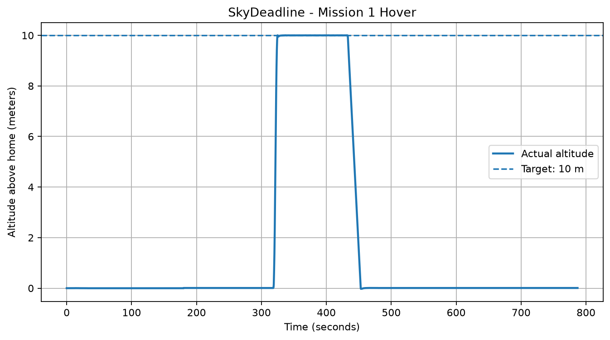
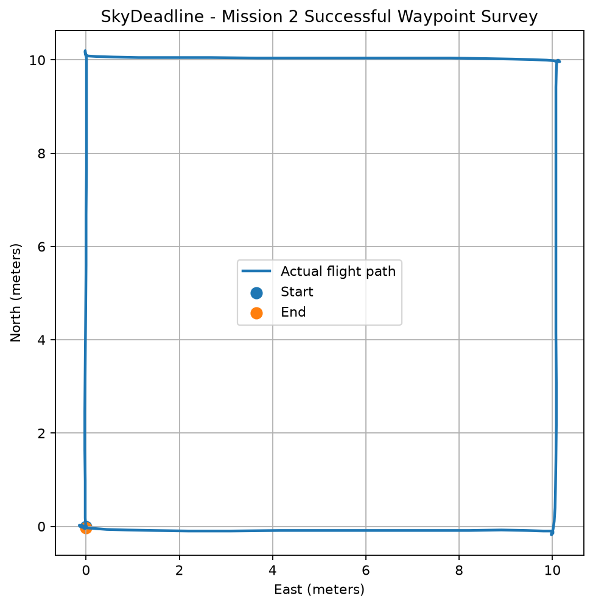
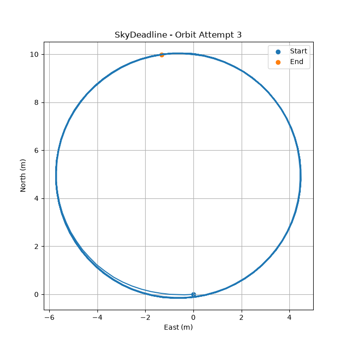

# SkyDeadline

**Detection-to-Mitigation Deadline Framework for On-Board UAV Intrusion Detection**

SkyDeadline is a research project investigating intrusion detection and response timing in unmanned aerial vehicle (UAV) systems. The project develops a simulation and telemetry foundation for evaluating detection behavior and end-to-end response deadlines.

## Research Team

| Contributor | Responsibility |
|---|---|
| Dylan Fayad ([@dylanfayad-pixel](https://github.com/dylanfayad-pixel)) | Student A — Systems, Simulation & Telemetry |
| Student B | Detection System & Host-Side Development |

## Phase I.0 — Baseline Validation

### Student A — Simulation & Telemetry

**Status: Baseline flight tests completed**

Three baseline flight patterns were flown in ArduCopter Software-in-the-Loop (SITL), with telemetry recorded for subsequent analysis.

| Mission | Validation outcome | Evidence |
|---|---|---|
| Mission 1 — Hover | Passed | [Hover results](results/phase1/README.md) |
| Mission 2 — Waypoint Survey | Passed | [Survey results](results/phase1/README.md) |
| Mission 3 — Orbit | Passed | [Orbit results](results/phase1/README.md) |

### Mission Evidence

#### Mission 1 — Hover

The hover experiment targeted an altitude of approximately 10 meters. Recorded telemetry was used to examine altitude over time and assess the hover interval.



#### Mission 2 — Waypoint Survey

The waypoint survey used a 10 × 10 meter rectangular route at an approximately 10-meter target altitude. The controller verified arrival at each of four waypoints within its configured tolerance and confirmed landing and disarming.



#### Mission 3 — Orbit

The orbit experiment used a configured radius of 5 meters. The recorded trajectory was plotted to visually inspect circular movement.



## Student B — Detection Development

The repository currently includes these detection components:

- `detectors/detector_stub.py`
- `detectors/mavlink_receiver.py`

Their joint behavior with Student A's simulation and telemetry has not yet been validated as an integrated end-to-end system.

## System Architecture

The intended Phase I.0 workflow is:

1. **Simulation:** ArduCopter SITL generates UAV flight behavior.
2. **Telemetry:** MAVLink messages expose vehicle state for monitoring and analysis.
3. **Detection:** The host-side receiver and detector process incoming telemetry.
4. **Deadline evaluation:** The integrated system will evaluate detection and response timing against the project's defined criteria.

The end-to-end workflow remains an integration objective until joint tests are completed.

## Repository Structure

```text
SkyDeadline/
├── detectors/
│   ├── detector_stub.py
│   └── mavlink_receiver.py
├── scripts/
│   └── waypoint_survey.py
├── docs/
│   └── phase1/
│       └── student_a_baseline_report.md
├── results/
│   └── phase1/
│       ├── README.md
│       ├── hover_01_plot.png
│       ├── survey_04_success_plot.png
│       └── orbit_01_attempt3_plot.png
├── requirements.txt
└── README.md
```

## Reproducibility & Evidence

Student A's baseline report and visualization index are available here:

- [Student A — Phase I.0 Baseline Report](docs/phase1/student_a_baseline_report.md)
- [Flight Results & Graphs](results/phase1/README.md)
- [Waypoint Survey Controller](scripts/waypoint_survey.py)

Raw telemetry recordings and earlier experimental attempts are preserved in the local working environment. They are not currently included in this results package.

## Current Research Status

**Completed**
- ArduCopter SITL environment setup.
- Hover, waypoint survey, and orbit baseline flights.
- Telemetry recording and flight-path visualization.
- Student A baseline documentation.

**Next milestone**
- Connect Student A's simulation and telemetry workflow to Student B's detection components.
- Establish a consistent time base.
- Test the end-to-end detection workflow and validate response timing against the project's defined requirements.

**Phase I.0 A+B integration is pending.** Baseline mission success does not, by itself, establish end-to-end detection or mitigation performance.
